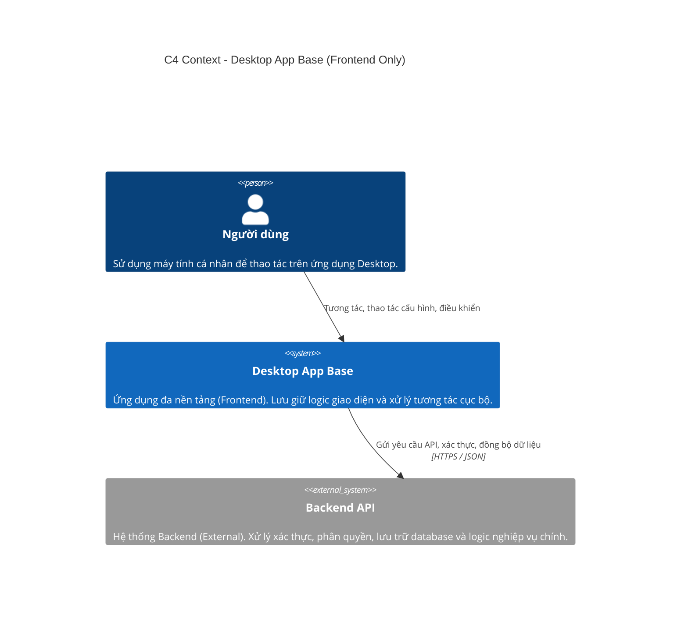
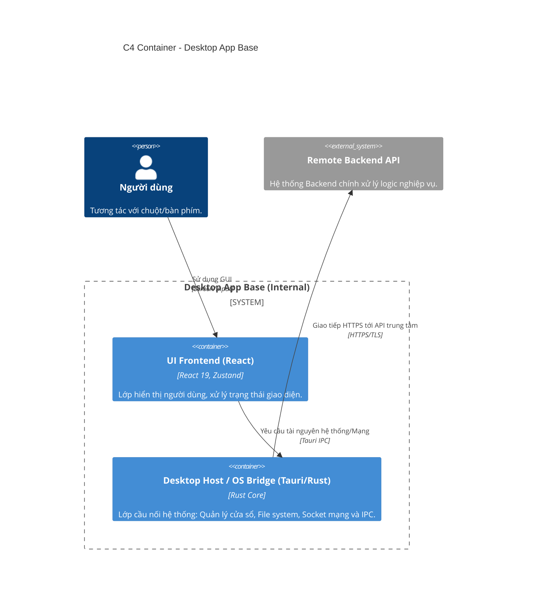

# Kiến trúc Hệ thống (Technical Master)

Tài liệu này mô tả kiến trúc tổng quan của **Ứng dụng Desktop Base (Frontend & OS Bridge)**, tập trung vào cấu trúc bên trong ứng dụng và cách nó tương tác với các hệ thống bên ngoài.

---

## 1. Kiến Trúc Vĩ Mô (Context Diagram)

Trong hệ thống ứng dụng Desktop, ứng dụng đóng vai trò là giao diện người dùng (Client-side), kết nối với hệ thống Backend Cloud và các dịch vụ bên ngoài.

**Lưu ý:** Dự án này bao gồm phần mã nguồn Frontend Desktop và Tauri OS Bridge. Toàn bộ logic nghiệp vụ tập trung và cơ sở dữ liệu chính nằm ở hệ thống **Backend Service** (Hệ thống bên ngoài).

---

## 2. Kiến Trúc Container (Container Diagram)

Kiến trúc bên trong dự án này bao gồm lớp hiển thị web (React) và lớp cầu nối với hệ điều hành (Tauri Core).

---

## 3. Vai trò của dự án này

1.  **Giao diện người dùng (Presentation Layer):** Cung cấp trải nghiệm ứng dụng desktop mượt mà, tối ưu trên máy tính.
2.  **Cầu nối Desktop (Desktop Host):** Tận dụng Tauri để truy cập vào các tính năng hệ thống mà trình duyệt web thông thường không làm được (file system, cửa sổ native, IPC, socket).
3.  **Tối ưu hiệu năng:** Chuyển các tác vụ nặng xuống lớp Rust để giảm tải cho Browser Engine.

**Dự án này KHÔNG chứa:** logic phân quyền database, lưu trữ persistent user data tập trung (trừ local state / cache), hoặc các tác vụ server-side.

---

## 4. Đánh giá Ưu - Nhược điểm và Kết luận Kiến trúc Vĩ mô

### 4.1 Ưu điểm (Pros)

- **Hiệu năng & Tối ưu Tài nguyên:** Trái ngược với các app Desktop dùng bộ khung Electron vốn kềnh càng và "ngốn" RAM, kiến trúc Tauri kết hợp Webview của hệ điều hành giúp ứng dụng cực kỳ nhẹ, tối ưu tài nguyên phần cứng.
- **Quyền năng OS-Native thực sự:** Khác với một Web-app thuần túy, cấu trúc Tauri OS Bridge cung cấp sức mạnh điều khiển Native thực sự (truy cập hệ thống, quản lý ứng dụng, giao tiếp thiết bị/socket).
- **Phục vụ đa Nền tảng (Cross-Platform):** Lớp mã nguồn React hoàn toàn có thể tái sử dụng, trong khi Tauri compile app Native cho thẳng Windows, macOS lẫn Linux từ duy nhất một codebase.

### 4.2 Nhược điểm (Cons)

- **Rào cản ngôn ngữ cho Cầu nối OS:** Việc viết thêm hay bảo trì các Module Native trên Tauri yêu cầu kiến thức lập trình ngôn ngữ Rust, một ngôn ngữ hiện đại an toàn nhưng có "độ dốc bài học" (learning curve) đối với nhà phát triển Frontend.

### 4.3 Kết luận (Conclusion)

Lựa chọn kiến trúc **Frontend Desktop dựa trên Tauri OS Bridge** là nước đi chiến lược phù hợp để phát triển ứng dụng Desktop chuyên nghiệp. Sự kết hợp này mang lại trải nghiệm phần mềm "Nhẹ như Web, Mạnh như Native", là nền tảng vững chắc (Base) để phát triển các dự án ứng dụng máy tính đa dạng.
