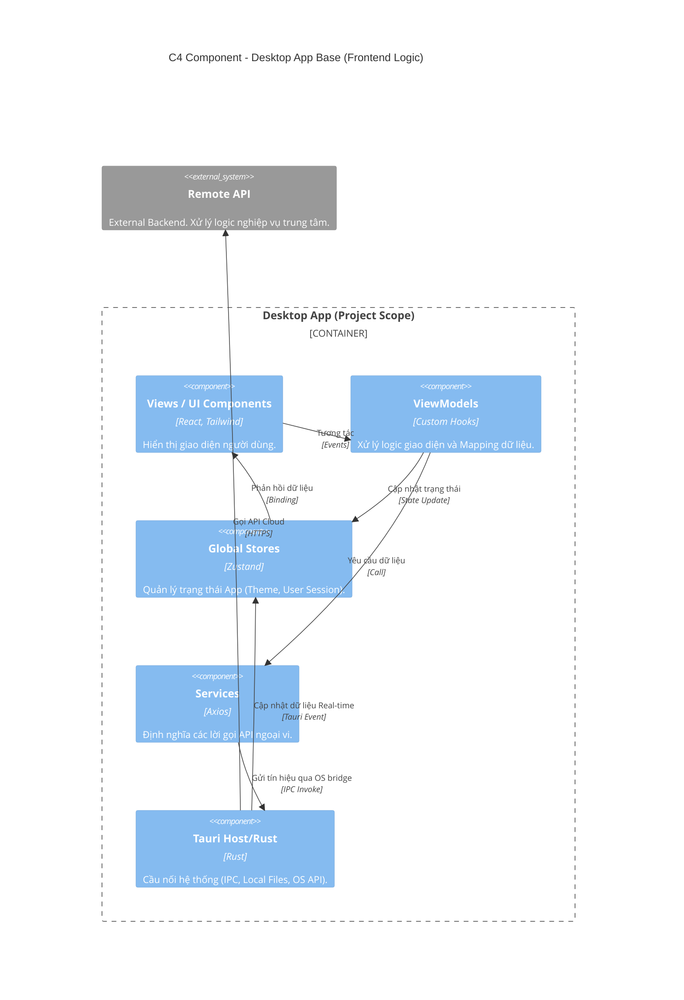

# Kiến trúc Mã nguồn (Code Architecture)

Tài liệu này mô tả chi tiết cách tổ chức mã nguồn bên trong **Ứng dụng Desktop Base (Frontend)**, tập trung vào mô hình MVVM và cách giao tiếp với các hệ thống Backend bên ngoài.

---

## 1. Sơ đồ Thành phần (C4 Component Diagram)

Sơ đồ này thể hiện cấu trúc logic bên trong dự án và ranh giới với hệ thống API bên ngoài.

---

## 2. Giao diện (Frontend Architecture)

Frontend của dự án được xây dựng dựa trên pattern **MVVM (Model - View - ViewModel)**. Mục đích là tách biệt hoàn toàn Logic nghiệp vụ (Business/State logic) ra khỏi Giao diện UI (Presentation).

### 2.1 Cấu trúc MVVM chi tiết

- **Models (`src/models/`):** Chứa định nghĩa kiểu dữ liệu (Interfaces/Types), và các logic nội bộ của đối tượng (không phụ thuộc vào framework UI).
- **Views (`src/views/`, `src/components/`):**
  - Chỉ chứa mã JSX hiển thị giao diện người dùng.
  - Sử dụng Tailwind CSS v4 để styling.
  - Hoàn toàn **"Mù" (Dumb)** về mặt Logic: View chỉ nhận Data từ ViewModel để render và phát ra các sự kiện (Events như `onClick`) trở lại cho ViewModel xử lý.
- **ViewModels (`src/viewmodels/`):**
  - Là "Não bộ" của View, được triển khai dưới dạng **Custom Hooks** (vd: `useLoginViewModel.ts`, `useSplashViewModel.ts`).
  - Gắn kết (Bind) View với các Global Stores (Zustand) hoặc gọi Service/API lấy dữ liệu ngoài.
  - Xử lý các Event từ View (Submit form, Click button).

### 2.2 Quản lý Trạng thái Toàn cục (Global State with Zustand)

Thư mục `src/stores/` quản lý state cho toàn ứng dụng sử dụng thư viện **Zustand**. Các stores được module hóa theo miền dữ liệu (Domains), ví dụ:

- `useAuthStore.ts`: Quản lý thông tin xác thực và phiên làm việc của người dùng.
- `useThemeStore.ts`: Quản lý chế độ sáng/tối hoặc Personalization.

### 2.3 Tầng kết nối Data (Services / API Layer)

Thư mục `src/services/` phụ trách việc định nghĩa các giao tiếp HTTP/IPC xuống dưới Backend.
Đây là nơi cấu hình Axios instances hoặc gọi trực tiếp `@tauri-apps/api/core` để `invoke` Rust commands.

---

## 3. Cầu nối Hệ điều hành (Desktop Host / OS Bridge - Tauri Architecture)

Thư mục `src-tauri/src/` chứa mã nguồn Rust, hoạt động như một System Host cung cấp các khả năng OS-native.

### 3.1 Nguồn Giao tiếp chính (Backend API)

- **Data Source:** Mọi dữ liệu nghiệp vụ chính từ Cloud đều được lấy qua **HTTP REST API** (hoặc WebSockets) gửi trực tiếp tới hệ thống backend độc lập.
- **Thực thi:** Tại tầng `src/services/` của Frontend (React), các HTTP Client (vd: Axios) thực hiện gọi API trực tiếp qua HTTPS mà **KHÔNG đi qua Tauri Rust Core**.

### 3.2 Vai trò của lõi Rust (Tauri OS Bridge)

Tauri (Rust) **không chứa logic nghiệp vụ cốt lõi hay truy xuất cơ sở dữ liệu**. Nó chỉ hoạt động như một Desktop Host cung cấp các đặc quyền mà Browser Sandbox không cho phép:

- **System Tray & Window Management:** Chạy ẩn dưới system tray, quản lý việc mở, thu nhỏ hoặc focus cửa sổ.
- **Local File System & Caching:** Tương tác ghi file settings cục bộ an toàn xuống ổ cứng OS.
- **Cập nhật tự động (OTA):** Gọi plugin `Updater` của Tauri để tự động tìm và cài đặt phiên bản mới.

---

## 4. Tổng kết Nguyên tắc Code

1. **Tránh nhồi nhét Logic vào View:** Tuyệt đối không gọi API (`fetch`/`axios`) hoặc viết logic phức tạp bên trong JSX component (`src/views`). Mọi tác vụ này chuyển vào ViewModel hoặc Store.
2. **Tận dụng Type System:** Luôn khai báo Type/Interface cho Data DTOs trả về từ Tauri để đảm bảo TS biên dịch an toàn ở Frontend.
3. **Rust Handle System Heavy Tasks:** Các tiến trình tốn thời gian như mở socket TCP, thao tác File Hệ thống, xử lý Cryptography nên được đẩy xuống Rust Command thay vì làm trên Browser Thread bằng JS.

### 4.2. Tiêu chuẩn Mã nguồn Chi tiết (Coding Skills)

Tài liệu kiến trúc này `02-code-architecture.md` quy định **Cấu trúc (Structure)** và **Luồng dữ liệu (Data Flow)**.

Để thực thi mã nguồn đúng chuẩn (Syntax, Framework conventions, UI/UX aesthetics), tất cả Lập trình viên (Human) và AI Agents (Copilot, Cursor, Codeium...) **BẮT BUỘC** phải tham chiếu tới các hướng dẫn chi tiết được định nghĩa trong thư mục `.agent/skills/`:

- **Giao diện & Trải nghiệm (UI/UX)**: Tham chiếu kỹ năng `ui-ux` và `tailwindcss-v4` để đảm bảo code ra giao diện mượt mà, đúng chuẩn Tailwind mới nhất.
- **Tauri Core**: Tham chiếu kỹ năng `tauri-v2` khi thao tác với các module Rust.

_Lưu ý cho AI Agent: Khi được yêu cầu Implement một Component hoặc Service mới dựa trên kiến trúc này, hãy tự động `view_file` các file `SKILL.md` tương ứng trong `.agent/skills/` trước khi generate code._

---

## 5. Đánh giá Ưu - Nhược điểm và Kết luận

### 5.1 Ưu điểm (Pros)

- **Hiệu năng & Tối ưu Tài nguyên:** Trái ngược với các app Desktop dùng bộ khung Electron vốn kềnh càng và "ngốn" RAM, kiến trúc Tauri kết hợp thư viện Rust và Webview hệ điều hành giúp ứng dụng cực kỳ nhẹ, tối ưu tài nguyên phần cứng.
- **Tách biệt Mối quan tâm (Separation of Concerns):** Mô hình MVVM giúp phân tách rõ ràng UI logic tĩnh và Business Logic/State động. Việc chỉnh sửa giao diện không chạm rủi ro đến logic gọi API, và việc thay đổi endpoint API cũng không làm vỡ giao diện (Component).
- **Quyền năng OS-Native thực sự:** Khác với một Web-app thuần túy, cấu trúc Tauri OS Bridge cung cấp sức mạnh điều khiển Native thực sự.
- **Phục vụ đa Nền tảng (Cross-Platform):** Lớp mã nguồn React hoàn toàn có thể được gom khối (build) để dùng cho phiên bản Web/Mobile web nếu có chiến lược mở rộng, trong khi Tauri compile app Native cho thẳng Windows, macOS lẫn Linux.

### 5.2 Nhược điểm (Cons)

- **Độ phức tạp Khởi điểm (Initial Complexity):** Framework MVVM cùng hệ thống Store yêu cầu lập trình viên phải hiểu rõ về flow kiểm soát trạng thái (State Lifecycle), đòi hỏi đầu tư ban đầu về thiết lập "khuôn mẫu" (boilerplate) nhiều hơn kiểu viết code React đan xen logic truyền thống.
- **Rào cản ngôn ngữ cho Cầu nối OS:** Việc viết thêm hay bảo trì các Module Native trên Tauri yêu cầu kiến thức lập trình ngôn ngữ Rust đối với Frontend Developer.

### 5.3 Kết luận Kiến trúc (Conclusion)

Việc ra quyết định lựa chọn **Kiến trúc MVVM chạy trên vỏ bọc Tauri OS Bridge** là nước đi chiến lược phù hợp với **Dự án App Desktop Base**.

Sự kết hợp này vừa khai thác triệt để sức mạnh đồ họa, sự phong phú linh hoạt của hệ sinh thái Web (React/Tailwind), đồng thời lại đem đến cảm quan của một phần mềm Desktop "Quyền Lực": nhẹ nhàng, phản hồi nhanh và được bao bọc trong một "lồng kính" bảo mật của Rust.
